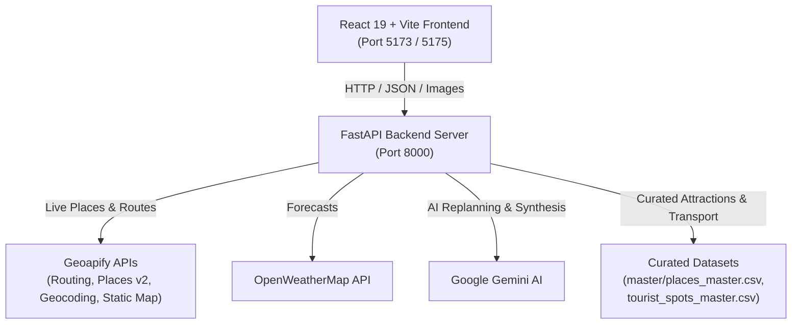

# 🧭 AI Voyage Planner

> An intelligent, AI-powered travel planner and itinerary generator tailored for destinations across India. Features live geospatial routing, full-scale India static maps, time-period-aware recommendations, meal-specific dining, strict duplicate prevention, and dynamic disruptions replanning.

---

## Key Features

* **Complete India Interactive & Route Mapping**
  * Centered on India (`79.5°E, 22.0°N`, zoom `4.2`, `1000x650`) to display the entire subcontinent from North to South without cropping.
  * Live route polylines with distinct Origin (`O` in emerald) and Destination (`D` in crimson) markers.
  * Responsive container with `object-fit: contain` fitting all desktop, tablet, and mobile screens.

* **Time-Period-Specific Activity Curation**
  * **Morning:** Parks, botanical gardens, beaches, temples, lakes, nature walks, viewpoints, and breakfast spots.
  * **Afternoon:** Museums, art galleries, shopping centers, historic forts, monuments, and indoor science/heritage centers.
  * **Evening:** Sunset points, beaches, waterfront promenades, entertainment hubs, night bazaars, and evening cafes.
  * Guaranteed minimum of **at least 2 verified, unique places** for each morning, afternoon, and evening slot.

* **Strict Deduplication & Uniqueness**
  * Zero repeat attractions across time slots, across different days, or between the scheduled itinerary and the "Discover / Recommended Places" slider.

* **Destination Proximity Validation**
  * Every attraction is verified using Great Circle (Haversine) distance checks ($\le 40\text{ km}$ from destination center) to ensure recommendations genuinely belong to the destination.

* **Strict Exclusion of Accommodations**
  * Hostels, hotels, lodges, homestays, dormitories, motels, and PGs are strictly excluded from tourist attractions.

* **Meal-Specific Restaurant Recommendations**
  * Curates 3 distinct dining venues per meal period (Breakfast, Lunch, Dinner).
  * Respects dietary preferences (Vegetarian / Non-Vegetarian) and enforces proximity checks ($\le 25\text{ km}$).

* **Weather & Carbon Sustainability**
  * Live weather forecasts via OpenWeatherMap.
  * Carbon emission tracking based on distance and transportation mode.

* **Smart Itinerary Replanner**
  * Instantly adapts plans when adverse weather, traffic, or sudden disruptions occur while preserving user-approved activities.

---

##  Architecture & Tech Stack



### Technology Matrix
* **Frontend:** React 19, Vite 8, React Router DOM 7, Vanilla CSS Design System.
* **Backend:** FastAPI, Uvicorn, Python 3.10+, Pandas, Requests, Geopy.
* **APIs:** Geoapify (Places API v2, Routing API, Static Maps v1), OpenWeatherMap, Google Gemini AI.

---

##  Repository Structure

```text
AI_VOYAGE_PLANNER/
├── .env.example             # Template for API keys
├── .gitignore               # Excludes secrets, node_modules, venv, caches
├── README.md                # Comprehensive project documentation
├── requirements.txt         # Core project Python dependencies
├── backend/
│   ├── main.py              # FastAPI application & business logic
│   └── requirements.txt     # FastAPI & Uvicorn dependencies
├── frontend/
│   ├── package.json         # React & Vite dependencies
│   ├── vite.config.js       # Vite configuration
│   └── src/
│       ├── App.jsx          # Route declarations
│       ├── App.css          # Design system, layout, responsive map styling
│       └── pages/
│           ├── Home.jsx     # Landing page
│           ├── PlanTrip.jsx # Trip configuration form
│           ├── Results.jsx  # Day-by-day itinerary, map, meals, discover
│           └── ...
└── data/
    ├── master/              # Master destination & tourist spots datasets
    └── Tourist spot/        # City-specific destination POI files
```

---

##  Getting Started

### 1. Prerequisites
Ensure you have the following installed:
* **Python**: `3.10` or higher
* **Node.js**: `18.0` or higher
* **npm**: `9.0` or higher

---

### 2. Clone & Environment Setup

1. **Clone the repository:**
   ```bash
   git clone <repository-url>
   cd AI_VOYAGE_PLANNER
   ```

2. **Configure Environment Variables:**
   Copy `.env.example` to `.env`:
   ```bash
   cp .env.example .env
   ```
   Open `.env` and fill in your API credentials:
   ```env
   # Google Gemini API Key
   GEMINI_API_KEY=your_gemini_api_key_here

   # OpenWeatherMap API Key
   OPENWEATHER_API_KEY=your_openweather_api_key_here

   # Geoapify API Key
   GEOAPIFY_API_KEY=your_geoapify_api_key_here
   ```

---

### 3. Backend Setup

1. **Create and activate a virtual environment:**
   * **Windows (PowerShell):**
     ```powershell
     python -m venv venv
     .\venv\Scripts\Activate.ps1
     ```
   * **macOS / Linux:**
     ```bash
     python3 -m venv venv
     
     ```

2. **Install backend dependencies:**
   ```bash
   pip install -r backend/requirements.txt
   ```

3. **Start the FastAPI backend server:**
   ```bash
   uvicorn backend.main:app --reload --host 127.0.0.1 --port 8000
   ```
   * The API will be available at: `http://127.0.0.1:8000`
   * Interactive Swagger documentation: `http://127.0.0.1:8000/docs`

---

### 4. Frontend Setup

1. **Navigate to the frontend directory:**
   ```bash
   cd frontend
   ```

2. **Install dependencies:**
   ```bash
   npm install
   ```

3. **Start the development server:**
   ```bash
   npm run dev
   ```
   * Open the local Vite URL displayed in your terminal (typically `http://localhost:5173` or `http://localhost:5175`).

---

## 📡 Key API Endpoints

| Method | Endpoint | Description |
| :--- | :--- | :--- |
| `POST` | `/api/trips/plan` | Generates a complete day-by-day smart itinerary with activities, meals, weather, and route details |
| `POST` | `/api/trips/replan` | Adapts itinerary during disruptions while preserving user-approved activities |
| `GET` | `/api/routes/map` | Serves an uncropped full-India JPEG route map with origin and destination pins |
| `GET` | `/api/live/places` | Fetches live tourist attractions for a given city with accommodation filtering |
| `GET` | `/api/live/restaurants` | Retrieves meal-specific restaurants near an anchor point or destination |
| `GET` | `/api/weather` | Returns current weather and conditions for the destination |
| `GET` | `/api/health` | Health check endpoint returning status of data files and API credentials |

---

##  Verification & Testing

You can verify the backend endpoints and validation constraints directly:

```bash
# Check server health
curl http://127.0.0.1:8000/api/health

# Verify route map rendering (returns image/jpeg)
curl "http://127.0.0.1:8000/api/routes/map?origin=Bangalore&destination=Chennai" -o route_map.jpg

# Test plan generation
curl -X POST "http://127.0.0.1:8000/api/trips/plan" \
  -H "Content-Type: application/json" \
  -d '{
    "origin": "Bangalore",
    "destination": "Chennai",
    "start_date": "2026-10-10",
    "end_date": "2026-10-12",
    "travelers": 2,
    "budget": 15000,
    "interests": ["Culture", "Nature"],
    "lunch_preference": "vegetarian"
  }'
```

---

##  License

This project is open-source and available under the [MIT License](LICENSE).
